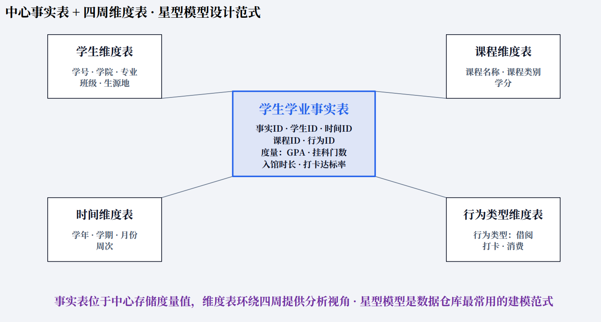
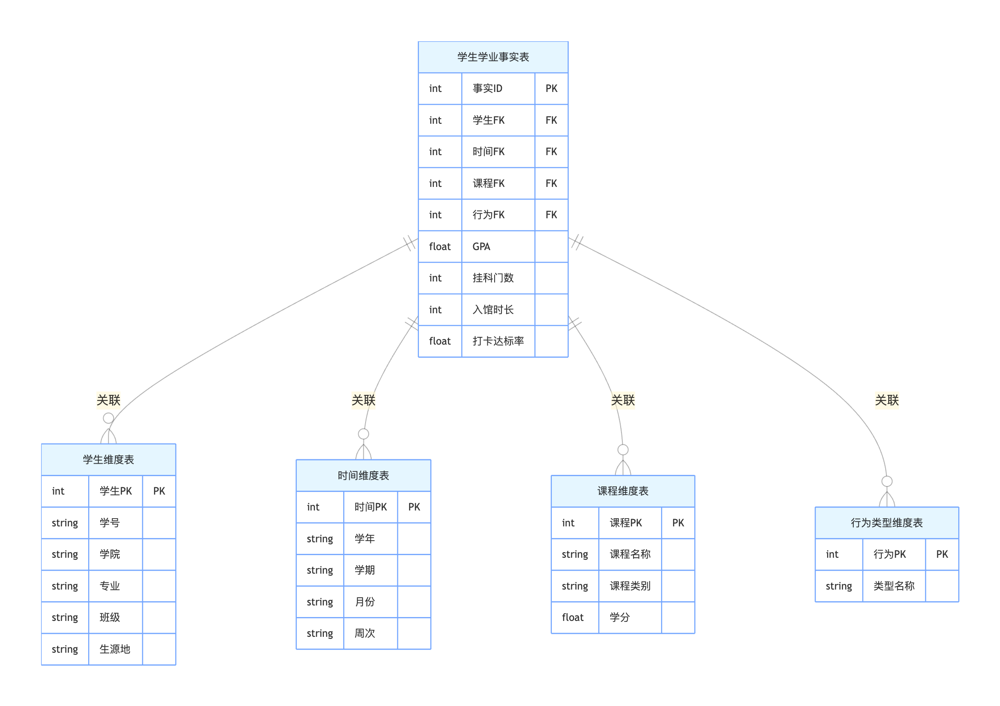
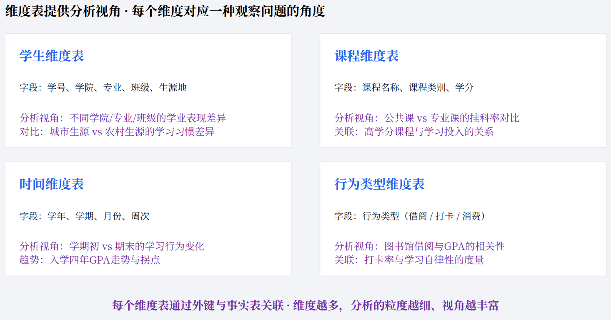
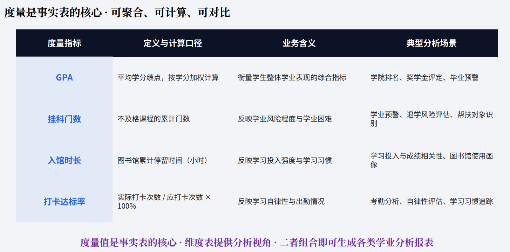

---
问题分析：学生学业成长主题数据集市
---

# 场景描述
**业务痛点**：学校现有多个独立业务系统
1. 教务系统：选课、成绩、挂科、重修、考勤、课程安排（OLTP，平时老师录成绩、学生选课）
2. 图书馆系统：借阅记录、入馆时长、书籍类别
3. 校园一卡通：早自习打卡、食堂消费、机房上机记录
4. 学工系统：评奖评优、违纪记录、资助信息、心理回访记录

**存在问题**：学校里，教务、图书馆、一卡通、学工系统是互相独立的。辅导员想要做学业预警、评优，需要把成绩、考勤、入馆、消费、资助信息拼在一起。如果直接去查教务、一卡通这些业务数据库写统计 SQL，会有如下问题：
> 各个系统数据库是孤立的（数据孤岛），字段标准不一样：比如有的写 “2024 级”、有的存 “24 级”；学号格式不统一
> 如果辅导员直接连教务库写 SQL 查：统计一个班近 3 学期挂科 + 借阅 + 打卡情况，查询很慢，**还会抢占数据库资源，影响学生选课、老师登分**（OLTP 库优先保障日常事务，不适合复杂多表汇总分析）
> 想要不同维度看数据：按学院 / 专业 / 班级 / 学期 / 生源地，做下钻、切片，原始业务库很难支持
> 数据质量差：缺打卡记录、成绩空值、重复借阅记录，业务库不会专门做清洗

**解决方案**：不是改造业务系统，而是搭建面向学工部门的学生学业成长数据集市，它属于小型、主题化的数据仓库，不需要一步搭建全校大而全的数据仓库，落地更快、成本更低。
1. **数据源：** 上面 4 个业务系统（源系统）
2. **ETL 链路：** 抽取 (Extract) → 清洗转换 (Transform) → 加载 (Load) 到集市
    - 清洗：统一学号、年级编码，剔除无效打卡、补全缺失标记，去重
    - 整合：把分散在多库的数据，统一到一张宽表 / 多维模型；
3. **多维模型：** 采用经典的星型模型（一张事实表，周围挂多张维度表）
> 事实表：**学生学业事实表**
    - 度量指标（可聚合的数值）：平均绩点、挂科门数、重修次数、学期入馆总时长、借阅图书数量、早自习打卡达标率、月消费均值；
> 维度表（用来切片、下钻）
    - 学生维度：学号、姓名、学院、专业、班级、生源地、入学年份、是否贫困生
    - 时间维度：学年、学期、月份、周次（单独时间维度是数仓经典设计）
    - 课程维度：课程名称、课程类别（通识课 / 专业课）、学分
    - 行为类型维度：借阅、打卡、消费、考勤
 
 

4. 建好集市之后，可以支撑如下的分析应用：
> **学业预警分析**：自动筛选连续两学期绩点低于 2.0 + 入馆时长显著偏少的学生，推送给辅导员重点关注
> **学情对比**：同一个专业，不同班级挂科率对比；同一年级，生源地学业表现对比
> **行为关联探索**：打卡稳定、经常泡图书馆的学生，挂科率是不是更低？（简单相关性分析，衔接后面数据挖掘）
> **评优辅助**：综合成绩、考勤、阅读情况，快速筛选符合奖学金候选条件学生，不用跨系统手动导出 Excel 拼接
 
 

5. 集市是只读的分析副本，查询不会影响原始业务系统。

# 思考问题
1. 这个场景，是适合先做数据集市，还是直接搭建全校统一数据仓库？理由是什么？
2. 星型模型里，为什么要单独建一张时间维度表，而不是直接在事实表里存日期？
3. ETL 过程中，发现同一个学生在一卡通里有大量缺失打卡数据，你会怎么处理？直接删掉？填充？标记？
4. 这个集市的数据，多久同步一次比较合适？实时同步？每日凌晨同步？为什么？
5. 隐私风险：集市里包含学生成绩、消费、心理回访数据，在使用上有哪些约束？（引出数据安全、数据权限）

# 案例小结
> 这个场景没有复杂技术，核心体现数仓思想：**把 “面向业务操作的数据”，经过同步、清洗、重组，变成面向分析决策的数据副本**。
> 现实中绝大多数单位，优先落地部门级数据集市，而不是一步到位建设庞大的数据仓库，成本更低、见效更快。

# 提交答案
1. 填写 [在线表格](https://docs.qq.com/form/page/DYkdkZUNaUVZ6WkFm)
2. 或扫码
 